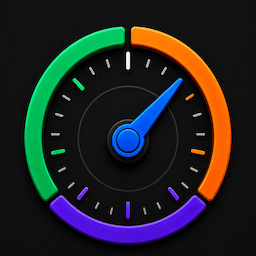
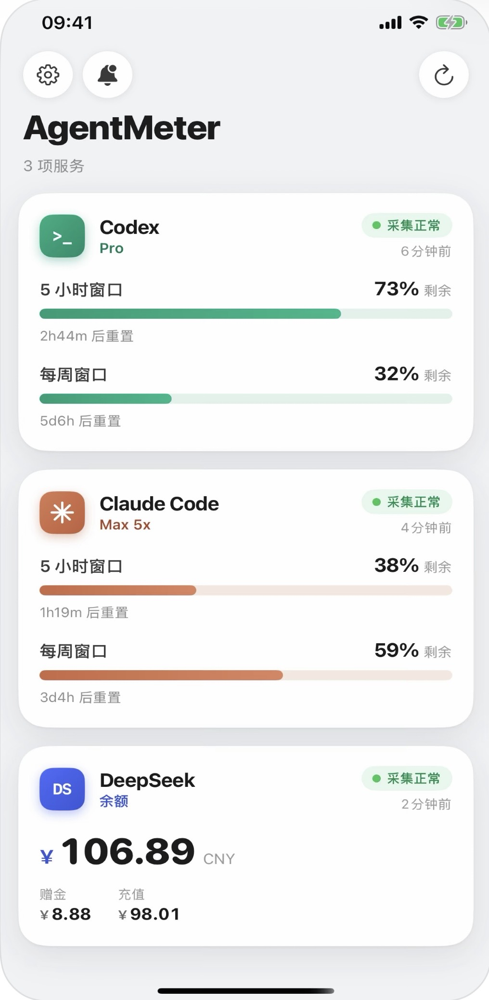
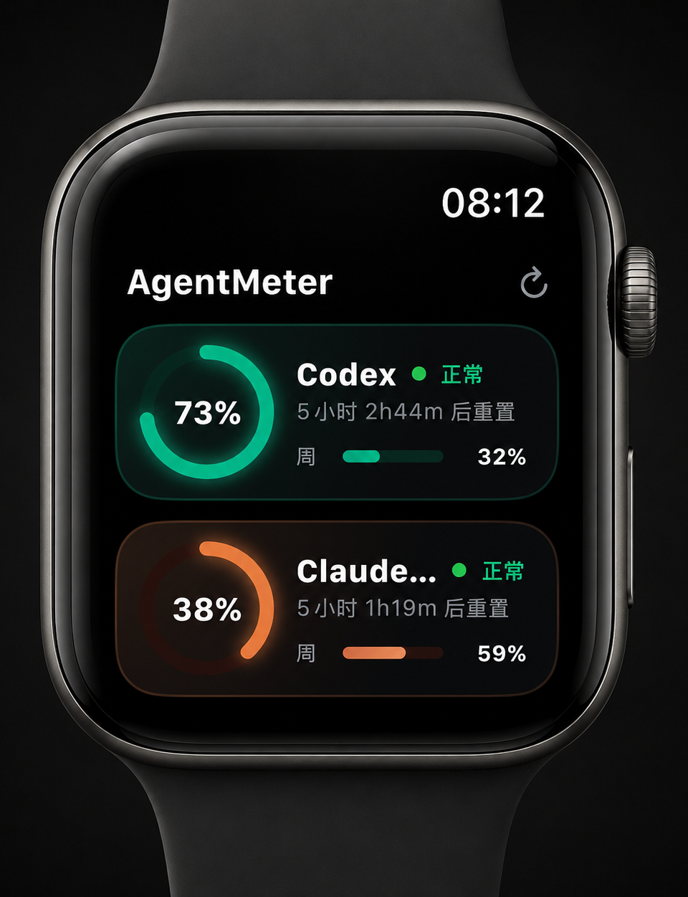
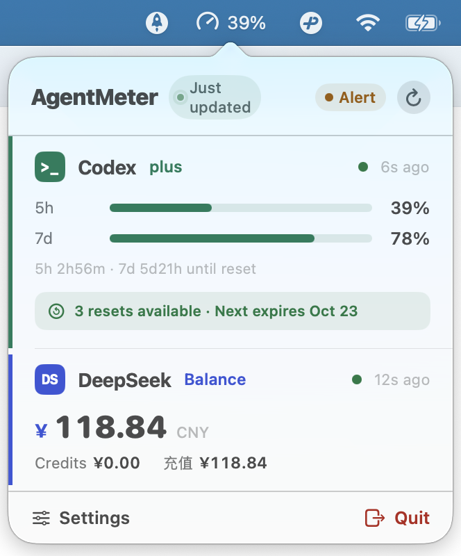

<div align="center">



# AgentMeter — AI coding quota tracker for iPhone

**English** · [简体中文](README.zh-CN.md)

</div>

Check how much **Claude Code, OpenAI Codex, Cursor and GitHub Copilot** quota you have left before starting a coding session. The Mac companion syncs your usage to iPhone and Apple Watch. On iPhone, **Reset Radar** also shows the likelihood of an upcoming Codex quota reset.

**[Download AgentMeter for iPhone and Apple Watch on the App Store](https://apps.apple.com/app/id6781480047)**

<a href="https://apps.apple.com/app/id6781480047"></a>

## Codex reset predictions on iPhone

Open **Reset Radar** to see the estimated probability of a Codex quota reset within the forecast window. Read the public signals for and against it, or add the Radar widget to your Home Screen or Lock Screen to follow the probability. To see when **your own account** is due to reset, check the countdown on its quota card.

## Quota on iPhone, Apple Watch and the Mac menu bar

<table>
  <tr>
    <td align="center"></td>
    <td align="center"></td>
    <td align="center"></td>
  </tr>
  <tr>
    <td align="center"><sub><b>iPhone</b> · Your usage in one place</sub></td>
    <td align="center"><sub><b>Apple Watch</b> · Status on your wrist</sub></td>
    <td align="center"><sub><b>Mac</b> · Check while you work</sub></td>
  </tr>
</table>

- **Choose a tool for your next task.** Compare remaining quota and reset times on iPhone. Each plan shows the windows its provider reports, from rolling five-hour limits to weekly allowances and monthly cycles.
- **Know when to return.** If a fresh reading shows less than 10% left in a five-hour window, an optional reminder can notify you at reset time. Codex also offers expiry reminders for unused reset credits.
- **Check away from your desk.** Put quota on an iPhone widget or an Apple Watch complication. The last update time tells you how recent the reading is.
- **Pick up interrupted Codex work.** On Mac, optional auto-resume can queue eligible Codex Desktop sessions after a quota limit clears.
- **Track API spending.** Check balances for services such as DeepSeek and OpenRouter, or review OpenAI API and Anthropic API costs by day, week or month.

## Get started on iPhone

1. **[Install AgentMeter from the App Store](https://apps.apple.com/app/id6781480047).** You can open Reset Radar immediately. To collect Kimi Code, GLM Coding Plan or MiniMax Token Plan usage on iPhone, add the provider in Settings.
2. **Connect your Mac for desktop coding tools.** Install the companion below. Enable the tools you use in its settings. Claude Code, Codex and Cursor use your existing Mac sign-ins. For GitHub Copilot, enter a GitHub token on the Mac.
3. **See your quota across devices.** Enable iCloud with the same Apple Account on Mac, iPhone and Apple Watch. The watch reads synced quota. Manually entered credentials stay on the device where you added them.

### Install the Mac menu bar companion

[Download the Mac DMG](https://github.com/dothinkerlab/AgentMeter/releases/latest/download/AgentMeter.dmg) and drag **AgentMeter.app** into Applications, or install with Homebrew. The app requires macOS 13 or later and is signed and notarized.

```sh
brew install --cask dothinkerlab/tap/agentmeter
```

To update, run `brew upgrade --cask dothinkerlab/tap/agentmeter`. [Browse Mac releases](https://github.com/dothinkerlab/AgentMeter/releases).

## Supported services

Use the setup column to see which services you can connect on iPhone and which use the Mac companion.

| Data | Provider | Setup |
| --- | --- | --- |
| Coding-plan quota | Claude Code | Existing sign-in on your Mac |
| Coding-plan quota | Codex | Existing sign-in on your Mac |
| Coding-plan quota | Cursor | Existing sign-in on your Mac |
| Coding-plan quota | GitHub Copilot | GitHub token entered on Mac and stored in its Keychain |
| Coding-plan quota | Windsurf | Opt-in detection of an existing Mac sign-in or local quota cache |
| Coding-plan quota | JetBrains AI | Opt-in detection of an existing Mac sign-in or local quota cache |
| Coding-plan quota | Zed | Opt-in detection of an existing Mac sign-in or local quota cache |
| Per-model-group quota, synced from Mac to compatible iPhone and Watch apps | Google Antigravity | Standalone Antigravity CLI (`agy`) with an existing personal Google sign-in |
| Personal coding and agent plan quotas | Volcengine Ark Coding Plan and Ark Agent Plan | Volcengine access key pair on Mac with permission to query the selected plan |
| Coding-plan quota | Kimi Code | Provider settings on Mac or iPhone |
| Coding-plan quota | GLM Coding Plan | Provider settings on Mac or iPhone |
| Coding-plan quota | MiniMax Token Plan | Provider settings on Mac or iPhone |
| Local API balance and billing | DeepSeek | Provider credentials on each device |
| Local API balance and billing | OpenRouter | Provider credentials on each device |
| Local API balance and billing | Kimi API | Provider credentials on each device |
| Local API costs | OpenAI API | Credentials with access to organization-level costs |
| Local API costs | Anthropic API | Credentials with access to organization-level costs |
| Local API billing | xAI API | Management Key and Team ID |
| Mac-only team billing | Cursor Team | Team/Enterprise Admin API key |
| API balance and usage with opt-in Mac → iPhone sync | TypeSafe API (Jev) | Chrome console session (Auto, default) or manually pasted Cookie header |
| Perplexity account credits with opt-in Mac → iPhone sync | Perplexity | Chrome session (Auto) or Cookie/session token (Manual); collection and sync default off |

Available metrics depend on the provider. OpenAI API and Anthropic API costs refer to developer API usage, not ChatGPT or Claude web/app subscriptions. Coding-plan quota can sync through private iCloud; **API billing remains local except for explicitly enabled Jev display sync**, and Cursor Team member identities and amounts stay on Mac.

### Special service setup

- **Google Antigravity:** [Install the standalone CLI](https://antigravity.google/docs/cli/tutorial/) (v1.1.11 or newer), open `agy` in Terminal, and sign in with a personal Google account. Then enable **Google Antigravity** under **Settings → Plan**. AgentMeter reads remaining quota and reset times by model group through the CLI’s read-only `/usage` command. Private iCloud sync makes those readings available to compatible iPhone and Apple Watch apps on the same Apple Account. Enable monitoring on one Mac only. Turning it off clears the cloud record. If you're coming from Gemini CLI, see [Google's migration announcement](https://github.com/google-gemini/gemini-cli/discussions/27274). Enterprise plans, API billing, and purchased AI credits are outside this integration.
- **TypeSafe API (Jev):** explicitly enable it on Mac and connect through the selected Chrome profile's console session or a manual Cookie header; an inference API key cannot replace a console session. The first connection may request Keychain access. Data stays on Mac by default; opt-in sync shares display data with iPhone, widgets and Watch without sending credentials to iCloud. See [connection, accounting and sync details](docs/TYPESAFE.md).
- **Perplexity account credits:** explicitly enable it on Mac using a fixed Chrome profile or a manual Cookie/session token. View recurring, purchased and bonus credits, with separate opt-in display sync; developer API cost history is not included. See [setup, calculation and sync details](docs/PERPLEXITY.md).

The Jev and Perplexity integrations use undocumented web interfaces that may change or require browser verification. Failed refreshes retain the last successful data; check its update time.

## Privacy and sync

Each collecting device queries providers using its own local credentials. AgentMeter does not send those credentials to us or write them to iCloud.

- **Existing Mac sign-ins:** Claude Code credentials are read from Keychain. For Codex, AgentMeter checks Keychain and falls back to `~/.codex/auth.json` when no entry exists. Cursor and Windsurf databases and JetBrains AI quota files are opened read-only. Zed credentials are read from the matching local Keychain item and are never refreshed or modified by AgentMeter.
- **TypeSafe console sessions:** automatic cookies stay in memory; manual Cookie headers use the device-local Keychain. Only the fixed TypeSafe console origin receives them, and redirects are refused. TypeSafe credentials never enter CloudKit. Opt-in Jev sync stores only display facts in a separate private record.
- **Perplexity web sessions:** Auto cookies stay in memory; Manual credentials stay in the local Keychain. Requests go only to the fixed Perplexity credits endpoint and refuse redirects. Optional sync uses a separate private display record containing credits, timestamps and state, never cookies or profile identities.
- **Manually entered credentials:** stored in the local Keychain, with iCloud Keychain synchronization and backup migration to another device disabled.
- **Private quota sync:** only cleaned coding-plan status—such as quota windows, reset times, subscription tier, reset-credit availability, and freshness information—is written to your private CloudKit database. Provider credentials and upstream reset-credit IDs are excluded.
- **Local billing:** billing records remain on the collecting device except for opt-in Jev display sync. Perplexity account credits use their own optional display sync. Cursor Team member identities and amounts remain on the Mac holding the Admin API key.
- **Device boundaries:** Apple Watch reads synced quota and never receives provider tokens or connects directly to providers. iPhone queries only providers you explicitly configure on that device.

If a refresh fails, the app marks the data as stale. Sanitized diagnostics are generated only when you request an export.

## Troubleshooting and feedback

If devices show different quota values, first compare their **updated times** and check that they use the same Apple ID with iCloud enabled.

1. Export sanitized diagnostics from **Settings → About AgentMeter → Export Sanitized Diagnostics** on Mac, or **Settings → App Info** on iPhone.
2. Open the [Bug Report form](https://github.com/dothinkerlab/AgentMeter/issues/new?template=bug_report.yml).
3. Include reproduction steps, each affected device's updated time, and the diagnostic file.

Diagnostics include app and OS versions, quota and reset status, update times, local billing service status, and pending CloudKit writes. They exclude credentials, Keychain values, device names, raw logs, raw provider responses, and billing amounts. Review any screenshots or text you add before submitting.

## Building from source

This repository contains the **macOS companion** (`AgentMeterMac`) and **shared core package** (`AgentMeterCore`). The iPhone and Apple Watch apps are distributed through the App Store; their source is not included here.

Prerequisites: Xcode with a **Swift 6.2 or newer toolchain**, and **XcodeGen** to generate the Xcode project. Run all commands below from the repository root.

Run the core tests:

```sh
swift test --package-path Packages/AgentMeterCore
```

Generate and open the Xcode project:

```sh
xcodegen generate
open AgentMeter.xcodeproj
```

Select the **AgentMeterMac** scheme to build and run the Mac app.

The checked-in signing team and iCloud container belong to the maintainer. For your own build, set your Apple Developer Team in [`project.yml`](project.yml) and your CloudKit container in [`AgentMeterMac/AgentMeterMac.entitlements`](AgentMeterMac/AgentMeterMac.entitlements) before generating the project. Your own container is separate from the App Store app's container.

## Maintainer release validation

Every public Mac release must pass the [Mac + iPhone release checklist](docs/RELEASE_CHECKLIST.md) with the exact iPhone build installed from TestFlight. This includes CloudKit Production schema review and testing the app installed from the final downloadable DMG.

## License

[MIT](LICENSE.md) © 2026 dothinker lab.

## Disclaimer

AgentMeter reads quota data from **unofficial, undocumented** Claude Code, Codex, GitHub Copilot, and [Cursor dashboard endpoints](https://github.com/Noisemaker111/openusage-opencode/blob/main/docs/providers/cursor.md), as well as Windsurf and JetBrains AI local cache formats and Zed's client API. These interfaces may change or stop working at any time. Copilot currently requires a manually supplied token and does not support GitHub Enterprise. Cursor Team uses Cursor's [official Admin API](https://docs.cursor.com/en/account/teams/admin-api) and requires an administrator-created key. Other integrations use their providers' APIs, which may also change. Using these services may be subject to each provider's terms of service. Use AgentMeter at your own risk.

AgentMeter is an independent project and is **not affiliated with, endorsed by, or sponsored by** any listed provider. Provider and product names are trademarks of their respective owners.
