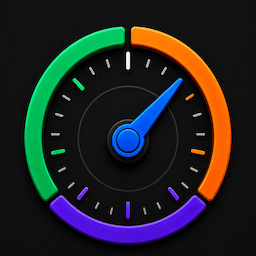
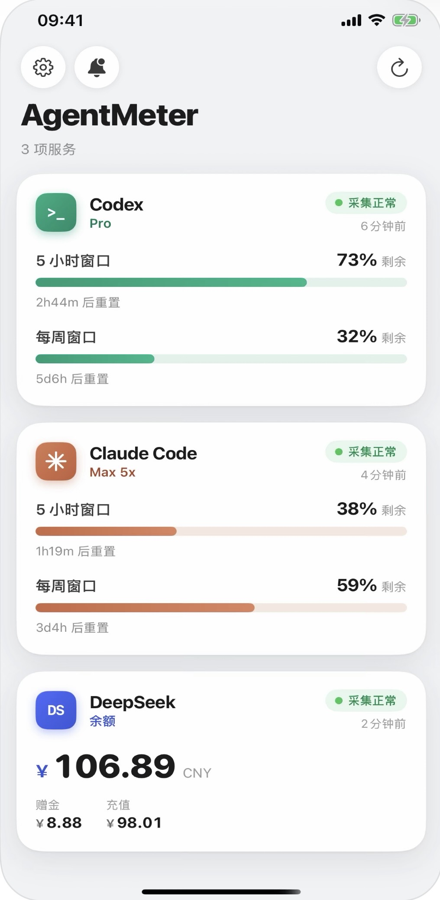
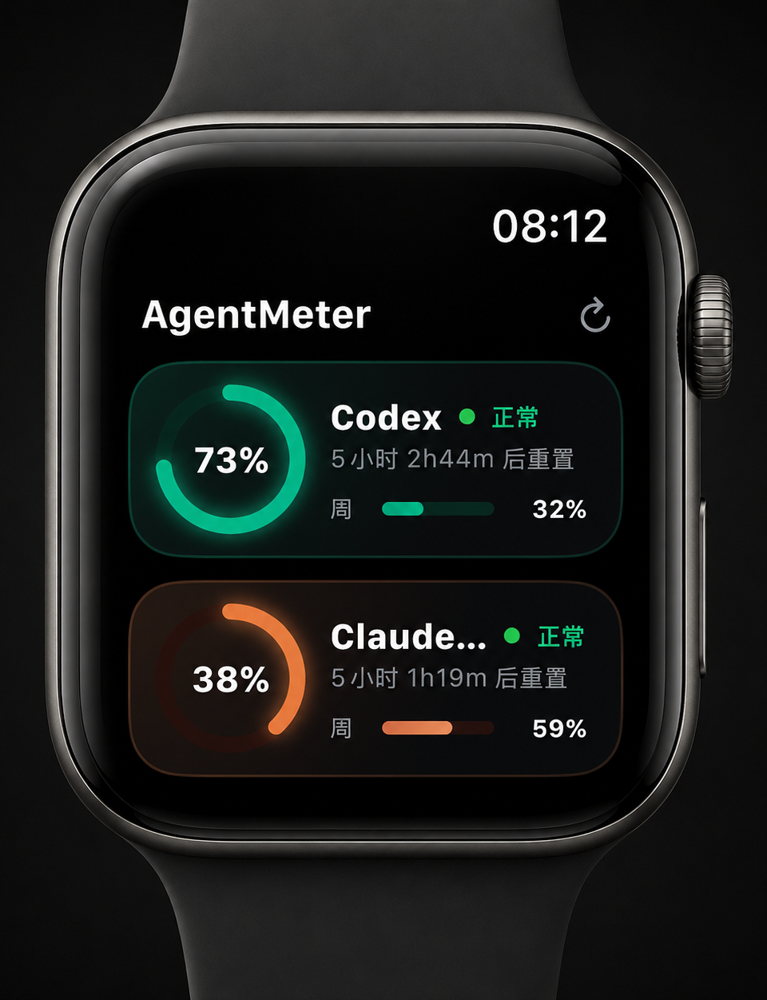
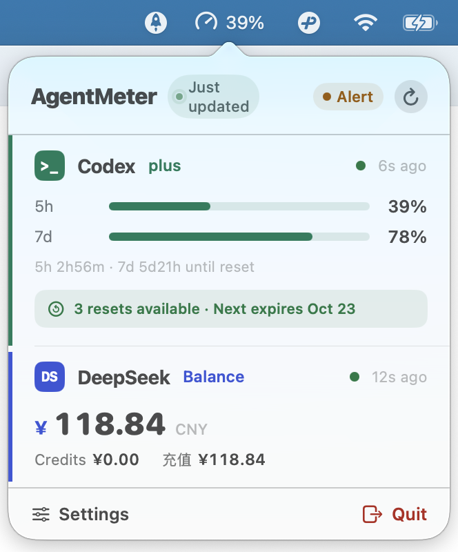

<div align="center">



# AgentMeter — iPhone 上的 AI 编程额度监控工具

[English](README.md) · **简体中文**

</div>

开始下一项编程任务前，在 iPhone 上看一眼 **Claude Code、OpenAI Codex、Cursor 和 GitHub Copilot** 各剩多少额度、何时重置。Mac 伴侣可把这些工具的用量同步到 iPhone 和 Apple Watch。想知道 Codex 近期有没有可能重置额度，还可以看 iPhone 上的 **Reset Radar（重置预测）**。

**[在 App Store 下载 iPhone 和 Apple Watch 版 AgentMeter](https://apps.apple.com/app/id6781480047)**

<a href="https://apps.apple.com/app/id6781480047"></a>

## 在 iPhone 上查看 Codex 重置预测

打开 **Reset Radar**，可以看到预测时段、该时段内 Codex 发生额度重置的估计概率，以及支持或反对这一判断的公开信号。把 Radar 小组件放到主屏幕或锁屏，就能随时查看概率。想知道**自己的账户**何时恢复额度，可以查看套餐卡片上服务商给出的重置倒计时。

## 在 iPhone、Apple Watch 和 Mac 菜单栏查看额度

<table>
  <tr>
    <td align="center"></td>
    <td align="center"></td>
    <td align="center"></td>
  </tr>
  <tr>
    <td align="center"><sub><b>iPhone</b> · 集中查看用量</sub></td>
    <td align="center"><sub><b>Apple Watch</b> · 抬腕查看状态</sub></td>
    <td align="center"><sub><b>Mac</b> · 工作时随时查看</sub></td>
  </tr>
</table>

- **决定下一项任务用哪个工具。** 在 iPhone 上比较各套餐的剩余额度和重置时间。按服务商提供的数据，可查看滚动 5 小时额度、周限额或月度用量。
- **额度恢复时再回来。** 开启重置提醒后，如果最新读数显示 5 小时额度剩余不足 10%，应用可在该窗口重置时通知你。Codex 未使用的重置次数（reset credits）也有到期提醒。
- **离开电脑也能看用量。** 把额度放到 iPhone 小组件或 Apple Watch 表盘上，抬腕就能查看。更新时间能帮你判断看到的是哪一次读数。
- **接着跑被限额打断的任务。** 在 Mac 上开启自动续跑后，额度恢复时，符合条件的 Codex Desktop 会话可重新加入队列。
- **查清 API 花了多少。** 可查看 DeepSeek、OpenRouter 等服务的余额，也可按日、周、月查看 OpenAI API 和 Anthropic API 的费用。

## 从 iPhone 开始使用

1. **[在 App Store 安装 AgentMeter](https://apps.apple.com/app/id6781480047)。** 打开 iPhone App 即可查看 Reset Radar。要在手机上采集 Kimi Code、GLM Coding Plan 或 MiniMax Token Plan 的用量，在设置中添加对应服务即可。
2. **连接 Mac 上的编程工具。** 安装下方的 Mac 伴侣，在设置中启用常用工具。Claude Code、Codex 和 Cursor 可读取 Mac 上已有的登录。GitHub Copilot 需要在 Mac 上输入 GitHub Token。
3. **跨设备查看额度。** 在 Mac、iPhone 和 Apple Watch 上使用同一 Apple 账户并开启 iCloud，手表即可读取同步的额度。手动输入的凭据保存在输入它的设备上。

### 安装 Mac 菜单栏伴侣

[下载 Mac 版 DMG](https://github.com/dothinkerlab/AgentMeter/releases/latest/download/AgentMeter.dmg)，将 **AgentMeter.app** 拖入「应用程序」，也可以使用 Homebrew 安装。应用支持 macOS 13 及以上版本，已签名并通过 Apple 公证。

```sh
brew install --cask dothinkerlab/tap/agentmeter
```

升级时运行 `brew upgrade --cask dothinkerlab/tap/agentmeter`。[查看 Mac 历史版本](https://github.com/dothinkerlab/AgentMeter/releases)。

## 支持的服务

可在「配置方式」一栏查看哪些服务能在 iPhone 上直接连接，哪些需要 Mac 伴侣。

| 数据类型 | 服务商 | 配置方式 |
| --- | --- | --- |
| 编程套餐额度 | Claude Code | 使用 Mac 上已有的登录 |
| 编程套餐额度 | Codex | 使用 Mac 上已有的登录 |
| 编程套餐额度 | Cursor | 使用 Mac 上已有的登录 |
| 编程套餐额度 | GitHub Copilot | 在 Mac 输入 GitHub Token，保存在该设备的 Keychain |
| 编程套餐额度 | Windsurf | 显式启用后检测 Mac 上已有的登录或本地额度缓存 |
| 编程套餐额度 | JetBrains AI | 显式启用后检测 Mac 上已有的登录或本地额度缓存 |
| 编程套餐额度 | Zed | 显式启用后检测 Mac 上已有的登录或本地额度缓存 |
| 按模型组查看额度，支持从 Mac 同步到兼容的 iPhone 和手表 App | Google Antigravity | 独立 Antigravity CLI（`agy`）及已登录的个人 Google 账号 |
| 个人编程与智能体套餐额度 | 火山方舟 Ark Coding Plan、Ark Agent Plan | 在 Mac 上配置有权查询对应套餐的火山引擎 Access Key ID 和 Secret Access Key |
| 编程套餐额度 | Kimi Code | 在 Mac 或 iPhone 的服务商设置中配置 |
| 编程套餐额度 | GLM Coding Plan | 在 Mac 或 iPhone 的服务商设置中配置 |
| 编程套餐额度 | MiniMax Token Plan | 在 Mac 或 iPhone 的服务商设置中配置 |
| 本地 API 余额与账单 | DeepSeek | 在各设备配置服务商凭据 |
| 本地 API 余额与账单 | OpenRouter | 在各设备配置服务商凭据 |
| 本地 API 余额与账单 | Kimi API | 在各设备配置服务商凭据 |
| 本地 API 成本 | OpenAI API | 使用有权查看组织级成本的凭据 |
| 本地 API 成本 | Anthropic API | 使用有权查看组织级成本的凭据 |
| 本地 API 账单 | xAI API | Management Key 和 Team ID |
| 仅限 Mac 的团队账单 | Cursor Team | Team/Enterprise Admin API key |
| 余额与用量（可选 Mac → iPhone 同步） | TypeSafe API（Jev） | Chrome 控制台会话（默认 Auto）或完整 Cookie header（Manual） |
| Perplexity 账户积分（可选 Mac → iPhone 同步） | Perplexity | Chrome 会话（Auto）或 Cookie／session token（Manual），采集与同步默认关闭 |

可用指标取决于服务商。OpenAI API 和 Anthropic API 成本指开发者 API 用量，不是 ChatGPT 或 Claude 网页端、应用端的订阅用量。编程套餐额度可通过私有 iCloud 同步；**API 账单默认不进入 CloudKit；Jev 可显式开启显示数据同步**，Cursor Team 成员身份与金额仅保留在 Mac 上。

### 特殊服务配置

- **Google Antigravity**：[安装独立 CLI](https://antigravity.google/docs/cli/tutorial/)（v1.1.11 或更新版本），在终端运行 `agy` 并登录个人 Google 账号，再到 **设置 → Plan** 启用 **Google Antigravity**。Mac 通过 CLI 的只读 `/usage` 命令，按模型组读取剩余额度和重置时间。兼容的 iPhone 和 Apple Watch 客户端可通过同一 Apple 账户的私有 iCloud 读取这些数据。每个账户只在一台 Mac 启用采集，关闭后会清除云端记录。使用旧 Gemini CLI 的个人用户可参考 [Google 的迁移公告](https://github.com/google-gemini/gemini-cli/discussions/27274)。企业套餐、API 账单和购买的 AI Credits 不在此集成范围。
- **TypeSafe API（Jev）**：在 Mac 显式启用，通过所选 Chrome profile 的控制台会话或手动 Cookie header 连接；推理 API key 不能替代控制台会话。首次连接可能请求 Keychain 授权。默认仅在 Mac 展示，开启同步后可向 iPhone、Widget 和 Watch 提供显示数据，凭据不进入 iCloud。详见[连接、数据口径与同步说明（英文）](docs/TYPESAFE.md)。
- **Perplexity 账户积分**：在 Mac 显式启用，使用固定 Chrome profile 或手动 Cookie／session token；展示周期、购买与奖励积分，可单独开启显示数据同步，不包含开发者 API 成本历史。详见[配置、计算与同步说明](docs/PERPLEXITY.zh-CN.md)。

Jev 和 Perplexity 的网页接口未公开，可能变化或要求浏览器验证。刷新失败时保留上次成功数据；请留意更新时间。

## 隐私与同步

每台采集设备使用自己的本机凭据查询服务商。AgentMeter 不会将这些凭据发送给我们，也不会写入 iCloud。

- **已有的 Mac 登录**：Claude Code 凭据从 Keychain 读取；Codex 优先读取 Keychain，找不到条目时读取 `~/.codex/auth.json`；Cursor 与 Windsurf 数据库和 JetBrains AI 额度文件均以只读方式打开；Zed 凭据只从同源的本机 Keychain 项目读取，AgentMeter 不刷新或修改这些凭据。
- **Perplexity 网页会话**：Auto Cookie 仅留内存，Manual 存设备本地 Keychain。仅请求固定积分端点并拒绝重定向；可选同步使用独立私有显示记录，只包含积分、时间和状态，不含 Cookie 或 profile 身份。
- **手动输入的凭据**：存入本机 Keychain，关闭 iCloud Keychain 同步及通过备份迁移至其他设备的能力。
- **私有额度同步**：仅将经过清理的编程套餐状态写入你的私有 CloudKit 数据库，例如额度窗口、重置时间、订阅档位、重置额度可用数量与数据更新状态；不包含服务商凭据或上游重置额度 ID。
- **本地账单**：账单记录默认保留在采集设备上；Jev 显示数据和 Perplexity 账户积分可分别显式开启私有云同步。Cursor Team 成员身份与金额只留在持有 Admin API key 的 Mac 上。
- **设备访问范围**：Apple Watch 读取已同步的额度，不接收服务商令牌，也不直连服务商；iPhone 只查询你在该设备上明确配置的服务商。

刷新失败时，应用会标记数据已过期。脱敏诊断仅在你主动导出时生成。

## 故障排查与问题反馈

如果各设备显示的额度不一致，请先比较**更新时间**，并检查是否使用同一个 Apple ID 开启了 iCloud。

1. 在 Mac 打开**设置 → 关于 AgentMeter → 导出脱敏诊断**，或在 iPhone 打开**设置 → App 信息**导出诊断。
2. 打开 [Bug Report 表单](https://github.com/dothinkerlab/AgentMeter/issues/new?template=bug_report.yml)。
3. 填写复现步骤、各受影响设备的更新时间，并附上诊断文件。

诊断包含应用与系统版本、额度与重置状态、更新时间、本地账单服务状态和待写入 CloudKit 的项目；不包含凭据、Keychain 内容、设备名称、原始日志、服务商原始响应或账单金额。提交前请检查你额外添加的截图和文字。

## 从源码构建

本仓库包含 **macOS 伴侣应用**（`AgentMeterMac`）和**共享核心包**（`AgentMeterCore`）。iPhone 与 Apple Watch 应用通过 App Store 分发，其源码不包含在本仓库中。

前置条件：包含 **Swift 6.2 或更新工具链**的 Xcode，以及用于生成 Xcode 工程的 **XcodeGen**。以下命令均从仓库根目录执行。

运行核心测试：

```sh
swift test --package-path Packages/AgentMeterCore
```

生成并打开 Xcode 工程：

```sh
xcodegen generate
open AgentMeter.xcodeproj
```

选择 **AgentMeterMac** scheme，构建并运行 Mac 应用。

仓库中的签名团队与 iCloud 容器属于维护者。构建自己的版本时，请先在 [`project.yml`](project.yml) 中设置自己的 Apple Developer Team，在 [`AgentMeterMac/AgentMeterMac.entitlements`](AgentMeterMac/AgentMeterMac.entitlements) 中设置自己的 CloudKit 容器，再生成工程。你自己的容器与 App Store 应用使用的容器相互独立。

## 维护者发布验收

每次公开发布 Mac 新版，都必须与通过 TestFlight 安装的实际 iPhone 构建完成 [Mac + iPhone 联合发布检查清单](docs/RELEASE_CHECKLIST.zh-CN.md)，包括 CloudKit Production Schema 检查，以及从最终下载 DMG 安装后的真包测试。

## 许可证

[MIT](LICENSE.md) © 2026 dothinker lab。

## 免责声明

AgentMeter 从 Claude Code、Codex、GitHub Copilot 与 [Cursor Dashboard](https://github.com/Noisemaker111/openusage-opencode/blob/main/docs/providers/cursor.md) 的**非官方、未公开**端点，以及 Windsurf、JetBrains AI 的本地缓存格式和 Zed 客户端 API 读取额度数据，这些接口可能随时变动或失效。Copilot 当前要求手工提供 Token，不支持 GitHub Enterprise；Cursor Team 使用 Cursor [官方 Admin API](https://docs.cursor.com/en/account/teams/admin-api)，并要求管理员创建 key。其他集成使用各服务商 API，也可能发生变化。使用这些服务可能受各自服务商的服务条款约束，请自行承担风险。

AgentMeter 为独立项目，**与文中列出的任何服务商均无隶属、背书或赞助关系**。所有服务商与产品名称均为各自权利人的商标。
